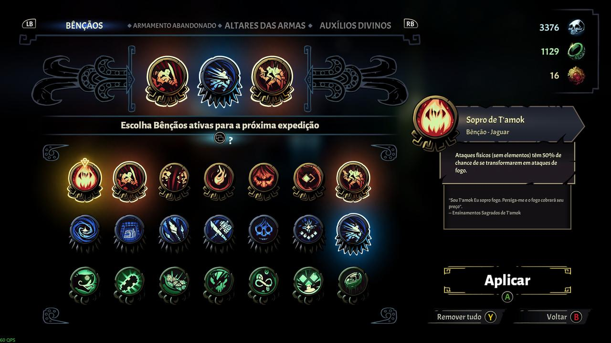
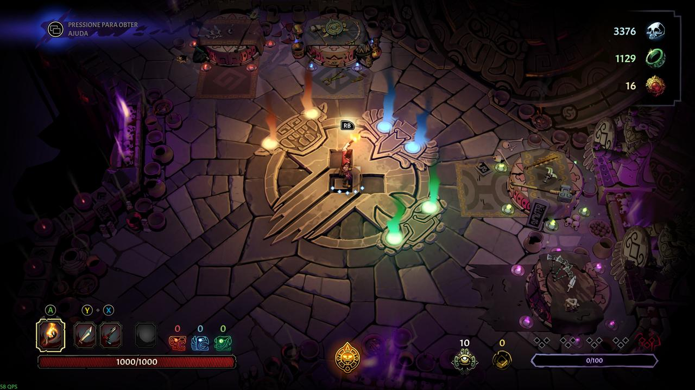
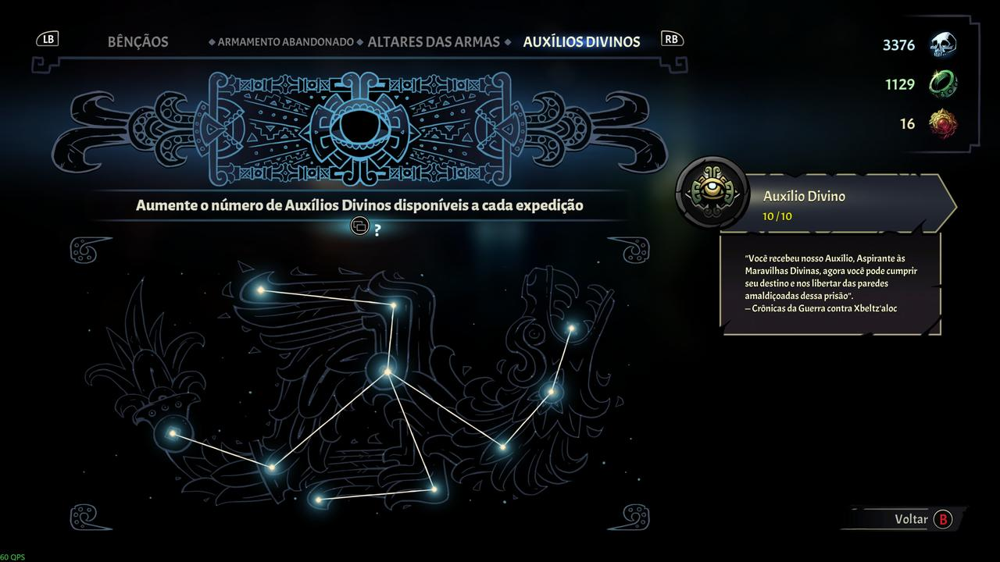
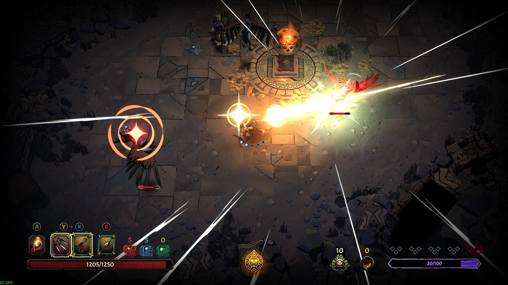
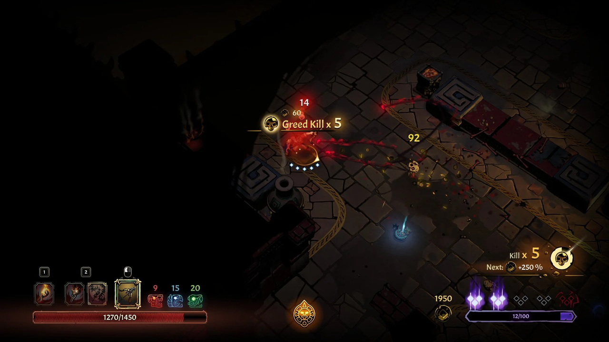

<!--
.. title: Review: Curse of the Dead Gods (PC)
.. slug: review-curse-of-the-dead-gods-pc
.. date: 2026-11-08 20:30:00 UTC-03:00
.. tags: PC, Roguelike, Isométrico, Fantasia Sombria, Indie, Ação
.. category: Review/PC
.. link: 
.. description: 
.. type: text
-->

Nos últimos anos, houve uma evidente ascensão do gênero (ou mecânica) **roguelike**. Ele se mesclou a diversos outros gêneros, sobretudo aos de **Ação** e **Plataforma**, chegando ao ponto em que praticamente qualquer jogo com salas aleatórias e mortes recorrentes já é imediatamente associado ao gênero. O título que se tornou um dos grandes representantes dessa popularização é **Hades**, conhecido tanto por seus amantes quanto por aqueles que torcem o nariz para a simples menção da palavra _rogue…_. Sua fama é tamanha que até mesmo quem nunca o jogou (eu me incluo nessa) sabe reconhecer quando um _game_ é "estilo _Hades_".

É mais ou menos assim que vejo **Curse of the Dead Gods**: um "_hadeslike_" de ritmo cadenciado, que parece sentir uma espécie de [_schadenfreude_](https://pt.wikipedia.org/wiki/Schadenfreude) sempre que concede algum "benefício" ao jogador e que pode te matar até mesmo quando você pensa que venceu. Mas será que esse tempero sádico, adicionado à fórmula de _Hades_, é suficiente para cativar quem já está saturado do gênero _roguelike_?

# Ficha Técnica

{}

# Premissa e Proposta

Como mencionei anteriormente, _Curse of the Dead Gods_ se assemelha bastante a _Hades_. Ambos são _roguelikes_ e _dungeon crawlers_ com **visão isométrica**, nos quais a progressão acontece por uma sequência de salas formadas a partir de um conjunto de leiautes predeterminados, enquanto a disposição dos inimigos e das armadilhas varia a cada tentativa. O combate segue a fórmula _hack and slash_: o personagem dispõe de um ataque principal, um secundário e uma esquiva que, além de proporcionar mobilidade, concede alguns instantes de invulnerabilidade. O jogador também conta com o auxílio dos deuses, obtido por meio de bênçãos e de outros recursos encontrados durante a exploração dos templos.

Ainda assim, _Curse of the Dead Gods_ parece "espelhar" algumas das características de _Hades_, invertendo ou deslocando certos elementos de sua proposta. Se em _Hades_ o jogador controla um personagem **ágil**, capaz de encadear ataques rapidamente, em _Curse of the Dead Gods_ cada movimento é mais **cadenciado** e exige maior planejamento. Se um jogo coloca o jogador na posição de alguém que tenta escapar dos domínios coloridos do **Senhor do Submundo**, o outro o coloca diante da tarefa de invadir a morada decrépita do **Deus da Morte** em busca de seus tesouros. E, enquanto em um o jogador encarna um **deus**, no outro assume o papel de um simples **humano**.

# Gameplay

O jogo começa na imensa entrada que dá acesso aos três templos, associados aos deuses Jaguar, Serpente e Águia. Esse espaço também funciona como um _hub_, no qual o jogador pode selecionar as expedições, adquirir bênçãos, desbloquear armas e restaurar altares que oferecem recursos para as próximas incursões.

## Bênçãos

As bênçãos são bônus passivos que podem ser selecionados antes de iniciar a exploração de um dos três templos. Elas são desbloqueadas por meio da troca de **Caveiras de Cristal**, uma moeda especial que pode ser utilizada na Entrada do Templo. Ao todo, existem 21 bênçãos, divididas em três grupos que representam o favor de cada um dos deuses.

As bênçãos do deus Jaguar concentram-se em efeitos relacionados ao **fogo**, que pode iluminar o ambiente e causar dano contínuo aos inimigos; ao aumento da **Constituição**, que fortalece os pontos de vida do jogador; e à ativação da **Fúria**, que proporciona um aumento de 50% no dano causado, conforme o efeito da bênção.

Já as bênçãos do deus Águia priorizam melhorias nas mecânicas de **aparo**, efeitos de **enfraquecimento** e **atordoamento** em área, além do aumento da **Destreza**, atributo que amplia o dano causado.

Por fim, as bênçãos do deus Serpente concentram-se no aumento da **Percepção**, que melhora as chances de encontrar itens raros e a quantidade de ouro obtido, e na ampliação do limite de **Corrupção**.

A escolha das bênçãos permite adaptar o personagem a diferentes estilos de jogo. Dessa forma, o jogador pode priorizar a sobrevivência, o potencial ofensivo ou a obtenção de recursos, de acordo com suas preferências e objetivos para a expedição.

## Armas

As armas são divididas em três categorias: **Arma Principal**, **Arma Secundária** e **Arma de Duas Mãos**. O jogador pode equipar simultaneamente uma arma **Principal** e **Secundária**; ou somente a **Arma de Duas Mãos**; ou a tocha, utilizada principalmente para iluminar os ambientes e interagir com determinados elementos do cenário. Durante uma expedição, o jogador pode carregar consigo uma arma de cada categoria, além da tocha.

Cada categoria possui seus próprios tipos de armas, com características e estilos de combate distintos. Entre as Armas Principais estão espadas, garras, maças e lâminas de arremesso. Já as Armas Secundárias incluem escudos, revólveres, adagas e chicotes. Por sua vez, as Armas de Duas Mãos englobam lanças, armas pesadas, arcos e bombas. Uma arma pertencente a determinada categoria não pode ser equipada em outra.

De maneira geral, as Armas Principais permitem realizar ataques rápidos e executar sequências de golpes com baixo custo de **Resistência**. As Armas Secundárias complementam o conjunto ofensivo com recursos como ataques à distância, aparos aprimorados e finalizadores alternativos. Já as Armas de Duas Mãos costumam apresentar ataques mais lentos ou que exigem maior preparação, mas oferecem golpes poderosos, ataques em área ou outras vantagens específicas.

Além das características próprias de cada tipo, cada arma possui **Habilidades** e **Efeitos Passivos** que podem diferenciá-la de outras armas da mesma categoria. Seus atributos também variam conforme o nível e a raridade do equipamento, sendo que a raridade determina a quantidade máxima de modificadores adicionais que ele pode possuir.

A alternância entre as categorias de armas é realizada por meio de comandos específicos. Considerando o leiaute padrão de um controle de **Xbox**, os botões **X**, **Y** e **B** são utilizados, respectivamente, para equipar e atacar com a Arma Principal, a Arma Secundária e a Arma de Duas Mãos. A alternância entre os conjuntos de combate, entretanto, exige atenção, pois a mudança de postura não é instantânea.

Cada tipo de arma possui características compartilhadas entre equipamentos da mesma família. Por exemplo, os escudos ampliam a janela de tempo disponível para executar um aparo; as lanças causam mais dano quando atingem os inimigos com a extremidade da lâmina; e as lâminas de arremesso causam dano amplificado no último golpe de seu _combo_. Essas características influenciam diretamente a maneira como cada arma deve ser utilizada.

Um aspecto negativo é que as informações detalhadas sobre as características específicas dos equipamentos ficam concentradas somente no _hub_. Ou seja, é impossível a consulta durante uma expedição, sendo especialmente inconveniente quando o jogador encontra uma arma desconhecida e deseja saber suas propriedades antes de decidir se vale a pena utilizá-la.

As armas podem ser encontradas durante as expedições em baús e cofres, comprada nos **Altares de Armas** ou obtidas como recompensas por derrotar inimigos. Após descobertas, elas podem ser desbloqueadas permanentemente por meio do **Armamento Abandonado**, localizado na Entrada do Templo. Essa aquisição é feita com **Anéis de Jade**, uma moeda obtida durante as expedições.

Após serem desbloqueadas, as armas passam a integrar o conjunto de equipamentos que podem aparecer nos **Altares de Armas** da Entrada do Templo, permitindo que o jogador as selecione para suas próximas expedições sem custos adicionais. Inicialmente, apenas um desses altares está disponível, mas outros três podem ser restaurados mediante o uso de Caveiras de Cristal.

## Altares e Auxílios Divinos

Outro recurso que pode ser adquirido com Caveiras de Cristal são os **Auxílios Divinos**. O jogador pode desbloquear até dez unidades desse recurso, que permitem atualizar os itens disponíveis nos altares encontrados durante as expedições. Após o retorno ao _hub_, as unidades de Auxílio Divino gastas são restauradas. Também é possível encontrar unidades adicionais durante as explorações, mas essas ficam restritas à expedição em que foram obtidas e são perdidas ao seu término.

Durante as expedições, o jogador pode encontrar três tipos principais de altares: **Altares de Armas**, **Altares de Relíquias** e **Altares de Atributos**.

Os Altares de Armas permitem adquirir uma entre três armas geradas aleatoriamente. Os Altares de Relíquias oferecem uma escolha semelhante, disponibilizando três relíquias aleatórias. Já os Altares de Atributos permitem aumentar em cinco pontos um de dois atributos apresentados, sendo possível aprimorar ambos os atributos simultaneamente mediante o pagamento de uma quantia maior.

Os itens e aprimoramentos oferecidos nesses altares podem ser adquiridos por meio de **Ouro** ou, alternativamente, mediante uma oferta de sangue que aumenta a **Corrupção** do jogador. Essa segunda opção permite preservar os recursos financeiros, mas antecipa a punição das maldições e, consequentemente, aumenta os riscos da expedição.

É importante ressaltar que os equipamentos, as relíquias e os aprimoramentos obtidos durante uma expedição não são mantidos para a seguinte. Assim, cada incursão exige que o jogador construa novamente seu conjunto de recursos, adaptando-se aos itens encontrados e às oportunidades oferecidas pelos altares.

Além dos altares, as relíquias também podem ser encontradas em baús e obtidas ao derrotar inimigos. O jogador pode equipar até seis relíquias simultaneamente, podendo substituir uma delas ao encontrar outra mais vantajosa. Assim como as armas adquiridas durante a exploração, as relíquias permanecem disponíveis apenas até o término da expedição.

Cada relíquia oferece **Efeitos Passivos** que modificam as características do personagem, e seus efeitos podem variar conforme a raridade e o nível do equipamento. A combinação entre relíquias, armas e bênçãos permite criar diferentes estratégias, incentivando o jogador a adaptar sua abordagem às oportunidades encontradas durante cada incursão.

## Corrupção

Um dos principais aspectos que o jogador deve administrar durante as expedições é a **Corrupção**. Representada por um medidor que vai de zero a cem pontos, ela se acumula ao longo da exploração e, ao atingir seu limite, provoca o recebimento de uma maldição. Esse ciclo pode se repetir até que o jogador alcance a **Quinta Maldição**.

A Corrupção pode ser adquirida de três maneiras principais: ao atravessar portas que levam a novas seções do templo, ao ser atingido por determinados **Ataques Amaldiçoados**, identificados pela energia roxa, e ao realizar ofertas de sangue nos altares durante a expedição.

Ao preencher o Medidor de Corrupção, o jogador recebe uma maldição ao atravessar uma porta para uma nova seção. As primeiras quatro maldições são selecionadas aleatoriamente e, em geral, apresentam efeitos negativos acompanhados de alguma vantagem. Essas combinações alteram as regras da exploração e podem tanto prejudicar o jogador quanto abrir oportunidades para novas estratégias.

{}

A **Quinta Maldição**, entretanto, representa uma ameaça muito maior. Diferentemente das anteriores, ela não oferece uma vantagem compensatória e faz com que o personagem perca pontos de vida continuamente, até permanecer com apenas um ponto de vida. A partir desse momento, a expedição se transforma em uma corrida contra o tempo, exigindo que o jogador avance com cautela e eficiência para concluir seu objetivo antes de sucumbir aos efeitos da maldição.

Esse sistema constitui um dos principais elementos de tensão de _Curse of the Dead Gods_. A Corrupção não funciona apenas como uma penalidade por avançar no templo, pois também pode ser utilizada como moeda alternativa para adquirir equipamentos e aprimoramentos. Cabe ao jogador decidir quando vale a pena aceitar esse custo para obter uma vantagem imediata e quando é melhor preservar sua margem de segurança.

## Combate
O sistema de combate de _Curse of the Dead Gods_ apresenta comandos relativamente simples, mas exige precisão e conhecimento das características de cada arma. Embora não possua sequências de comandos excessivamente complexas, o jogo oferece diferentes combinações de ataques, finalizadores e habilidades que precisam ser utilizadas de maneira estratégica.

As Armas Principais e as Armas de Duas Mãos possuem sequências de ataques que variam conforme o tipo de equipamento. De modo geral, muitas dessas armas apresentam combos de três golpes, enquanto as espadas e as garras se destacam por suas sequências mais longas, com quatro e cinco golpes, respectivamente. Existem, entretanto, variações entre os tipos de arma e equipamentos específicos.

As Armas Secundárias possuem padrões de ataque próprios. Algumas realizam ataques individuais, enquanto outras, como os chicotes e as adagas, permitem golpes duplos. Além disso, atacar com a Arma Secundária durante o _combo_ com a Arma Principal acionará o **Finalizador de Combo** da Secundária, criando oportunidades para combinar os efeitos das duas armas. Esses ataques alternativos podem causar mais dano, interromper os inimigos ou oferecer vantagens táticas, dependendo do equipamento utilizado.

Além dos ataques, o jogador dispõe de dois recursos defensivos fundamentais: o **Aparo** e a **Esquiva**.

O Aparo é uma ferramenta defensiva extremamente eficaz, mas exige precisão no momento de sua execução. Trata-se de uma mecânica de alto risco e alta recompensa, pois permite neutralizar a maioria dos ataques quando executado corretamente, inclusive determinados golpes de chefes. Um aparo bem-sucedido também interrompe o adversário, pode aplicar o efeito de **Enfraquecimento**, que aumenta o dano recebido pelo inimigo em 50% durante um curto período, e recupera dois **Pontos de Resistência**.

Entretanto, errar o momento do Aparo pode deixar o personagem vulnerável aos ataques adversários. Por isso, embora essa mecânica ofereça grandes vantagens, sua utilização exige conhecimento dos padrões de ataque dos inimigos e capacidade de reação.

A Esquiva, por sua vez, costuma ser uma opção defensiva mais acessível. Além de proporcionar mobilidade para reposicionar o personagem durante o combate, ela concede um breve período de invulnerabilidade, permitindo evitar ataques e armadilhas. Quando executada no momento exato em que o personagem seria atingido, a esquiva é considerada **Esquiva Perfeita** e recupera um ponto de Resistência.

Apesar de sua utilidade, a Esquiva deve ser utilizada com atenção, pois consome um ponto de Resistência. O mesmo ocorre com os Finalizadores de _Combo_ e diversos ataques das Armas Secundárias e das Armas de Duas Mãos. O custo varia conforme o tipo de arma e o movimento executado.

A Resistência é, portanto, um recurso fundamental para o gerenciamento do combate. Quando seus pontos se esgotam, o jogador perde acesso temporário às ações que dependem desse recurso, ficando limitado principalmente aos ataques básicos da Arma Principal e ao Aparo. A Resistência se recupera automaticamente com o tempo, desde que o jogador interrompa as ações que impedem sua regeneração.

Nesse contexto, executar Esquivas Perfeitas e Aparos bem-sucedidos é especialmente vantajoso. Além de evitar danos, essas ações recuperam Resistência e permitem manter a pressão ofensiva sem depender exclusivamente da regeneração passiva. Dessa maneira, o jogo incentiva o domínio das mecânicas defensivas, recompensando o jogador que consegue alternar entre ataque e defesa com precisão.

Outro aspecto importante do combate é a interação entre **Luz** e **Escuridão**. Em áreas iluminadas, as armadilhas podem ser identificadas com maior facilidade, enquanto a escuridão impede sua visualização. Além disso, permanecer na escuridão aumenta em 50% o dano recebido pelo personagem, tornando a iluminação um elemento importante para a sobrevivência.

Para iluminar os ambientes, o jogador dispõe de uma **Tocha**, que pode ser utilizada para atacar por meio do botão **A**, considerando o leiaute padrão de um controle de **Xbox**. A tocha também permite acender determinadas fontes de luz e elementos do cenário, como piras, teias e gases inflamáveis. Inimigos em chamas também podem servir como fontes de iluminação.

Entretanto, os **Ataques Amaldiçoados** representam uma ameaça adicional, pois podem apagar as fontes de luz presentes no ambiente, com exceção da tocha. Dessa forma, o jogador precisa considerar não apenas os padrões de ataque dos adversários, mas também as condições de iluminação durante o combate. A escuridão torna os confrontos mais perigosos e aumenta a importância do posicionamento e do uso adequado dos recursos disponíveis.

Por fim, a mecânica de **Greed Kills** desempenha um papel importante na economia e no ritmo das batalhas. Seu objetivo é encadear eliminações em sequência, mantendo a pressão sobre os inimigos e evitando sofrer danos durante o processo. Cada eliminação consecutiva aumenta o contador de Greed Kills e a quantidade de Ouro obtida dos inimigos derrotados, com um bônus de 50% por eliminação adicional, até o limite de 500% ao atingir dez eliminações na sequência.

O contador pode ser mantido por meio de ataques, Esquivas Perfeitas e Aparos bem-sucedidos, que renovam seu tempo de duração. Entretanto, sofrer dano ou deixar o contador expirar interrompe a sequência e faz com que o jogador perca o bônus acumulado.

Essa mecânica recompensa um estilo de combate agressivo e eficiente, incentivando o jogador a eliminar os adversários rapidamente sem negligenciar a defesa. Ao mesmo tempo, cria uma relação interessante entre risco e recompensa: quanto mais longa a sequência de eliminações, maior o retorno financeiro, mas também maior a necessidade de manter o controle da batalha. Assim, o Greed Kills complementa os demais sistemas do jogo ao transformar a eficiência no combate em uma vantagem econômica para o restante da expedição.

# Progressão, Estrutura e Arte

Como mencionado anteriormente, a progressão de _Curse of the Dead Gods_ acontece por meio da exploração de **três templos**: Jaguar, Serpente e Águia. Cada um deles é dividido em três **níveis**, mas somente o primeiro nível está disponível no início do jogo.

O segundo nível é desbloqueado após o jogador obter uma determinada quantidade de **Medalhões**. Cada medalhão é concedido na primeira vez em que o jogador conclui um nível de um dos templos, o que exige derrotar seu chefe final. Para concluir o segundo nível, é necessário atravessar duas **seções** consecutivas, que combinam as salas dos dois primeiros níveis. Durante esse percurso, o jogador mantém o acúmulo de Corrupção adquirido ao longo da exploração. Entretanto, ao derrotar o chefe da primeira seção, é possível **purificar uma das maldições ativas**, à escolha do jogador.

De maneira semelhante, o terceiro nível é desbloqueado mediante a obtenção de uma quantidade adicional de medalhões. Sua exploração combina as três seções do templo, exigindo que o jogador conclua todas elas em uma única expedição. Assim como acontece no segundo nível, derrotar o chefe ao final de uma seção intermediária permite purificar uma das maldições ativas.

Por fim, existe o **Desafio Final**, que reúne três seções escolhidas aleatoriamente entre os três templos. Após concluir todas elas, o jogador precisa enfrentar o **Chefão Final**.

{}

Cada seção é composta por diversas salas interconectadas e organizadas em **camadas**. Ao todo, é necessário atravessar sete camadas, passando por uma das diversas salas disponíveis em cada uma delas. Ao concluir esse percurso, o jogador enfrenta o chefe da seção antes de avançar para a próxima, caso exista.

No **Mapa da Seção**, cada sala é representada por um ícone que indica o tipo de desafio a ser enfrentado e as possíveis recompensas. Entre as opções disponíveis estão baús de ouro, altares de armas, atributos, relíquias e aprimoramentos de armas, fontes de cura, desafios de ouro e salas de subchefes.

De maneira geral, cada sala funciona como uma pequena masmorra repleta de monstros e armadilhas, que o jogador precisa explorar até encontrar a porta de acesso à próxima sala.

A **Sala da Fonte de Cura**, entretanto, foge desse padrão. Ela consiste em uma ponte deserta, com uma fonte de cura posicionada no centro e uma porta ao final do percurso, que permite avançar rapidamente para a próxima sala.

Já as **Salas de Desafio** são grandes salões que apresentam um altar central, responsável por ativar desafios que concedem ouro ou itens como recompensa. Existem dois tipos de desafios: os de tempo, nos quais o jogador precisa derrotar um grupo de inimigos rapidamente, recebendo uma recompensa menor conforme o tempo passa; e os de combate, nos quais é necessário eliminar todos os adversários sem sofrer nenhum golpe.

Por fim, as **Salas de Subchefe** colocam o jogador diante de um dos chefes dos três templos, escolhido aleatoriamente. Derrotá-lo garante as mesmas recompensas concedidas pela conclusão de uma seção, com exceção da purificação de uma maldição. Essas salas aparecem exclusivamente nos mapas que combinam seções dos três templos.

## História e Narrativa

O protagonista de _Curse of the Dead Gods_ é **Caradog McCallister**, um explorador britânico, caçador de relíquias e aventureiro em busca de riquezas incalculáveis, vida eterna e poderes divinos. A história é direta e minimalista, concentrando-se na premissa clássica de exploração e ganância. Não há uma narrativa repleta de diálogos ou reviravoltas complexas: os principais acontecimentos são apresentados por meio de algumas animações curtas.

Entretanto, para aqueles que desejam conhecer melhor o universo de _Curse of the Dead Gods_, boa parte das informações está escondida nas notas do **Bestiário**, que apresentam trechos de conversas, relatos e passagens de diários relacionados às criaturas e aos acontecimentos do jogo.

{}

O principal problema dessa abordagem é que o jogo não deixa muito claro que essas informações existem. O Bestiário está disponível no menu, ao lado do Inventário, mas, para quem não demonstra muito interesse em consultar os detalhes sobre os monstros comuns do jogo, como foi o meu caso, é bastante provável que esse conteúdo passe despercebido.

Curiosamente, o que me levou a explorar o Bestiário foi a conquista **Memórias**, que exige completar todas as suas entradas. Foi somente por causa dela que descobri essa parte da narrativa, quando já acumulava aproximadamente 50 horas de jogo.

## Direção de Arte e Gráficos

_Curse of the Dead Gods_ apresenta uma direção de arte que combina fantasia sombria, estética de histórias em quadrinhos (ou xilogravura) e referências à arquitetura e à iconografia de civilizações mesoamericanas. O resultado é uma ambientação opressiva, misteriosa e perigosa, que reforça constantemente a sensação de estar explorando templos antigos e hostis.

O jogo aposta em um visual estilizado, com sombras intensas, iluminação dramática e utilização de _cel shading_, caracterizado por contornos marcantes e traços escuros em personagens, criaturas, objetos e elementos arquitetônicos. Essa técnica confere às figuras uma aparência ilustrada, semelhante à de desenhos de histórias em quadrinhos. As criaturas monstruosas, as armadilhas e as estruturas antigas complementam essa identidade visual, transmitindo a sensação de que os templos são lugares perigosos, protegidos contra a invasão de exploradores.

A ambientação também apresenta algumas variações de acordo com as áreas exploradas, embora a estrutura dos templos e a repetição de determinados elementos visuais possam tornar os cenários menos distintos após muitas partidas.

{}

O contraste entre **luz** e **escuridão** é um dos elementos mais marcantes da identidade visual do jogo. Tochas, braseiros e outras fontes de fogo iluminam partes do ambiente, destacando personagens, objetos e as tonalidades terrosas e acinzentadas das estruturas dos templos. Na ausência dessas fontes de iluminação, entretanto, a escuridão profunda esconde ameaças e faz com que as salas pareçam ainda mais imprevisíveis.

Essa alternância entre luz e sombras não funciona apenas como um recurso estético, mas também como parte fundamental da identidade e das mecânicas de _Curse of the Dead Gods_. Tudo isso é apresentado sob uma perspectiva **isométrica**, que permite acompanhar os combates e a exploração dos ambientes.

## Trilha Sonora e Áudio

A trilha sonora de _Curse of the Dead Gods_ cumpre seu papel de ambientar o jogador nos corredores e nas salas sombrias dos três templos dos Deuses Mortos. Entretanto, as músicas não são particularmente marcantes, sendo pouco provável que permaneçam na memória após algumas semanas sem ouvi-las.

Os efeitos sonoros, por outro lado, conferem peso às ações de **McCallister**, desde os passos sobre as pontes em ruínas até os ataques realizados com as diferentes armas de seu arsenal e os aparos perfeitos contra os golpes dos adversários. Os sons também complementam os sinais utilizados para indicar como e quando os inimigos irão atacar, contribuindo para que o jogador identifique os movimentos dos adversários e reaja adequadamente.

## Desempenho e Aspectos Técnicos

_Curse of the Dead Gods_ é um jogo bastante leve, principalmente devido à simplicidade de sua física, à quantidade relativamente reduzida de elementos simultâneos na tela e ao estilo gráfico em _cel shading_.

Mesmo em um computador modesto, equipado com um processador **Intel Core i5-12450H**, 16 GB de memória **DDR5** e uma placa de vídeo **NVIDIA GeForce RTX 2050 de 4 GB**, o jogo manteve, durante a maior parte do tempo, uma taxa de aproximadamente 60 quadros por segundo (QPS).

Não foi possível determinar a taxa máxima de quadros que esse computador conseguiria alcançar, pois limitei a taxa de atualização do jogo a 60 QPS. Ainda assim, ocorreram raros momentos de queda de desempenho, nos quais a taxa de quadros chegou à faixa dos 40 QPS.

Os testes foram realizados na resolução 4K (3840 × 2160 pixels), com escala de resolução de 80% e todos os efeitos gráficos e filtros ativados. Considerando essas configurações, o desempenho apresentado foi bastante satisfatório.

# Veredito

_Curse of the Dead Gods_ não apresenta grandes novidades para quem já conhece e aprecia os _hadeslikes_. Ainda assim, consegue se destacar dentro do gênero por sua abordagem mais sóbria e contida, tanto no ritmo da jogabilidade quanto em sua apresentação visual. O combate possui uma cadência bastante equilibrada: não é lento demais para quem está acostumado com o frenesi de _Hades_, nem rápido demais a ponto de exigir reflexos excepcionalmente apurados. Tudo isso sem deixar de recompensar a habilidade do jogador e punir aqueles que agem de maneira afobada.

O combate e o sistema de recompensas são envolventes o suficiente para manter o jogador interessado durante dezenas de expedições. Isso acontece mesmo diante da variedade relativamente limitada de cenários, já que é comum reencontrar os mesmos leiautes de salas ao longo das partidas, com pequenas alterações na quantidade de inimigos, armadilhas e baús.

_Curse of the Dead Gods_ é uma excelente porta de entrada para os _hadeslikes_, especialmente para jogadores que não estão acostumados a jogos de ação que exigem reflexos extremamente apurados. Para os veteranos do gênero, por outro lado, oferece uma experiência de combate acima da média, que pode ser resumida como um bom e velho feijão com arroz, acompanhado de batata frita e bife.
